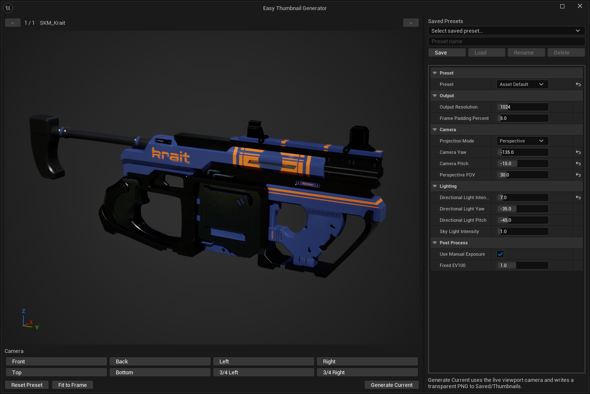
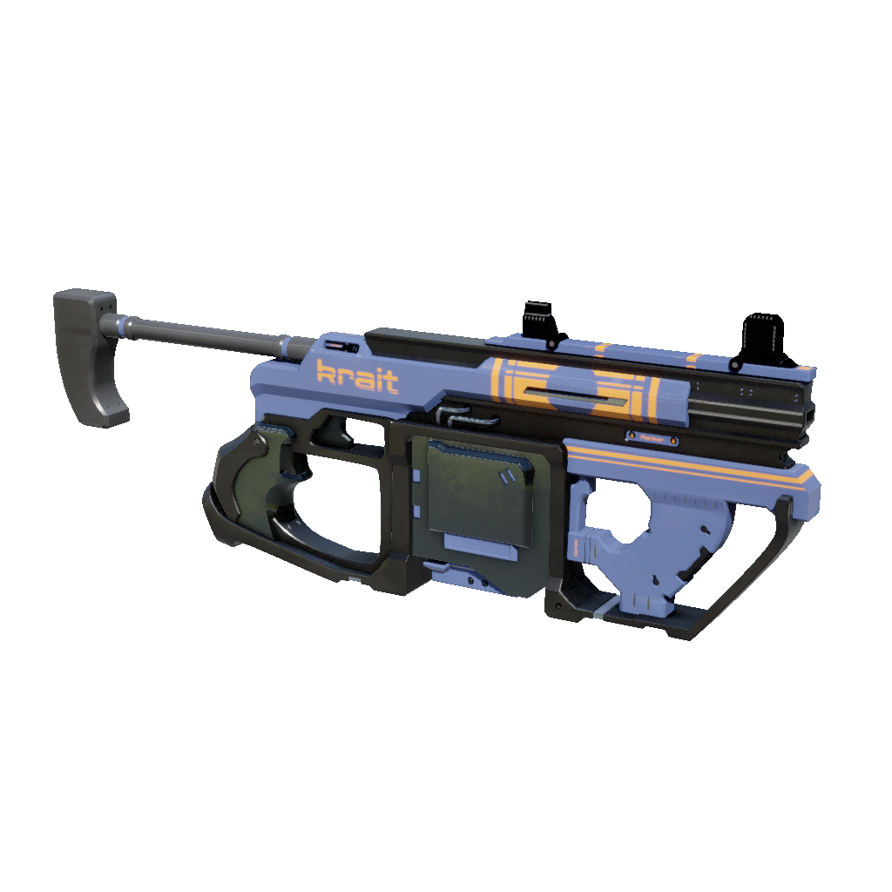

# Easy Thumbnail Generator

Native Unreal Engine editor plugin by **ZUPTI** for generating transparent PNG thumbnails from **Static Mesh** and **Skeletal Mesh** assets.

> **Target:** Unreal Engine 5.8  
> **Current version:** 1.5.0 (development)  
> **Type:** Editor-only C++ plugin  
> **License:** MIT

<p align="center">
  
</p>

The weapon shown in the preview is **Krait**, an in-game rifle from [**Kanka**](https://kanka.zupti.com), developed by **ZUPTI**. Krait was created by [**Arda Büyüktaş**](https://arda_buyuktas.artstation.com/).

## Overview

Easy Thumbnail Generator adds **Create PNG Thumbnail...** to the Content Browser context menu for Static Mesh and Skeletal Mesh assets.

The action opens a live editor preview where you can frame the asset, switch camera angles, tune lighting/exposure, save reusable presets, and generate transparent PNG thumbnails without leaving Unreal Editor.

Output is written to:

```text
<Project>/Saved/Thumbnails/<AssetName>.png
```

### Example output

<p align="center">
  
</p>

The image above is a generated transparent thumbnail of **Krait** using the plugin. Krait was created by [**Arda Büyüktaş**](https://arda_buyuktas.artstation.com/).

## Features

- Unreal Engine 5.8 native C++ editor plugin
- Static Mesh and Skeletal Mesh support
- Content Browser right-click integration with a camera-style action icon
- Live 3D preview before export
- Transparent PNG output, native Unreal Texture2D asset output, or both together
- Configurable PNG and Texture Asset output directories
- Filename templates and prefix replacement: `SM_Rock` + strip `SM_` + prefix `T_` becomes `T_Rock`
- Auto Increment / Overwrite / Skip Existing collision policies
- Material-aware rendering
- Perspective and orthographic projection
- Geometry-aware fit-to-frame based on projected mesh vertices
- Bounds visualizer in the live preview
- Optional checkerboard background for visualizing transparent areas
- Visible Content / Bounds Center / Pivot / Custom Offset framing modes
- Mouse orbit/pan/zoom in the preview viewport
- Camera shortcuts:
  - Front
  - Back
  - Left
  - Right
  - Top
  - Bottom
  - 3/4 Left
  - 3/4 Right
- Built-in starting presets:
  - **Weapon Side**
  - **Weapon 3/4**
  - **Asset Default**
  - **Custom**
- Named user presets with **Save / Load / Rename / Delete**
- Last-used settings are restored automatically per user/per project
- Multi-selection navigation with previous/next asset controls
- **Generate Current** preserves the current live viewport camera framing
- **Generate All** fits each selected asset independently while reusing the current camera direction and render settings
- Configurable:
  - output mode (PNG / Texture Asset / Both)
  - PNG output directory and Content Browser Texture Asset directory
  - source prefix to remove, output prefix and filename template
  - overwrite policy
  - output resolution
  - frame padding
  - framing mode and custom framing offset
  - live bounds visualization
  - checkerboard background preview
  - projection mode
  - FOV
  - camera yaw/pitch
  - directional light
  - skylight
  - fixed EV100 exposure

## Installation

Clone or copy this repository into the project's Plugins directory:

```text
<Project>/Plugins/EasyThumbnailGenerator/
```

Expected structure:

```text
<Project>/
└── Plugins/
    └── EasyThumbnailGenerator/
        ├── EasyThumbnailGenerator.uplugin
        ├── README.md
        ├── CHANGELOG.md
        ├── LICENSE
        ├── RELEASE_CHECKLIST.md
        └── Source/
```

Regenerate project files if needed, then build your Editor target with Unreal Engine 5.8.

## Usage

1. Open the Content Browser.
2. Select one or more **Static Mesh** or **Skeletal Mesh** assets.
3. Right-click and choose **Create PNG Thumbnail...**.
4. Adjust the live preview.
5. Optionally use a built-in preset, camera shortcut, or saved user preset.
6. Click **Fit to Frame** when you want automatic framing.
7. Use:
   - **Generate Current** for the currently previewed asset using the live viewport camera framing.
   - **Generate All** for batch generation across the current selection.
8. Find the PNG files in:

```text
Saved/Thumbnails/
```

## Output Workflow (v1.5.0 development)

**Output Mode** controls where the thumbnail goes:

- **PNG** (default): exports a PNG to the **PNG Directory** (default: `Saved/Thumbnails`, relative to the project root); an absolute filesystem directory also works.
- **Texture Asset**: creates/saves a native `UTexture2D` asset under **Texture Asset Directory** (default: `/Game/Thumbnails`).
- **Both**: writes PNG and Texture Asset with the **same generated name**.

**Filename Template** defaults to `{Prefix}{BaseName}`. Supported tokens are:

- `{AssetName}`: the original source asset name
- `{BaseName}`: the original name after removing the configured **Source Prefix to Remove**, if it matches the start
- `{Prefix}`: the new **Output Prefix**

For example, set `Source Prefix to Remove = SM_`, `Output Prefix = T_` and keep the default template. Source mesh `SM_Rock` produces `T_Rock.png` and/or `/Game/Thumbnails/T_Rock`, **not** `T_SM_Rock`. If `SM_` is absent, the prefix is simply added to the unchanged source name.

**Overwrite Policy**: `Auto Increment` (default, safe, adds `_1`, `_2`...), `Overwrite` (replaces the existing file or updates an existing `UTexture2D`), or `Skip Existing`. In **Both** mode, a collision on either destination triggers a common increment or skips both, ensuring matched names.

**Saved presets** and last-used settings store all destination, template, prefix, mode, and overwrite preferences. Existing presets load with legacy defaults (PNG-only, empty prefixes, `Saved/Thumbnails`, Auto Increment). The render/camera settings remain independent of output paths.

## Preview Workflow

The preview window intentionally owns the working settings. There is no separate plugin page under Project Settings.

### Built-in presets

**Weapon Side** is a side-profile starting point intended for weapon/catalog thumbnails.

**Weapon 3/4** uses a three-quarter view to expose more depth and silhouette.

**Asset Default** is a general-purpose starting point for arbitrary meshes.

Built-in presets use **Visible Content** framing by default. This mode measures the projected mesh geometry from the current camera direction and recenters the frame around the visible silhouette instead of relying only on the asset bounds box. **Bounds Center**, **Pivot**, and **Custom Offset** remain available when you want an explicit framing anchor.

Changing an individual setting switches the session to **Custom**.

### Saved presets

The **Saved Presets** panel lets you give the current setup a name and save it for later.

Saved presets and the last-used settings are stored as editor per-user/per-project configuration. They are not asset files and do not need to be committed to source control.

### Camera shortcuts

Camera shortcut buttons immediately change the view and refit the current asset. They are useful for quickly exploring a consistent silhouette before fine-tuning with the mouse.

`Fit to Frame` uses projected mesh vertex positions when CPU-side geometry data is available, which produces a tighter screen-space fit than projecting the full 3D bounds box. If that geometry data is unavailable, the plugin falls back to the bounds-based fit.

## Current vs Batch Generation

### Generate Current

`Generate Current` transfers the current preview camera location, rotation, FOV/orthographic zoom, lighting and output settings to the PNG renderer. This is intended to keep the generated framing as close as possible to what you composed in the live viewport.

### Generate All

`Generate All` uses the current camera direction, projection, lighting and output settings, but automatically fits each selected mesh to frame. This avoids applying the first asset's absolute camera distance to differently sized meshes.

## Transparent Background

The live preview uses an editor preview scene for useful lighting and material evaluation. PNG and Texture Asset outputs are rendered separately with an alpha-aware capture path, so the exported image keeps a transparent background rather than capturing the editor window itself.

For materials whose normal SceneColor alpha does not provide usable coverage (notably some translucent/additive cases), the renderer also captures a material-independent geometry mask as a fallback so visible geometry is not silently dropped from the exported PNG.

## Multi-Selection

When multiple supported meshes are selected, use the `<` and `>` buttons to inspect them individually.

Example output:

```text
Saved/Thumbnails/SM_Example.png
Saved/Thumbnails/SK_Example.png
```

## Source Layout

```text
EasyThumbnailGenerator/
├── EasyThumbnailGenerator.uplugin
├── README.md
├── CHANGELOG.md
├── LICENSE
├── RELEASE_CHECKLIST.md
├── Docs/
│   └── Images/
│       ├── easy-thumbnail-generator-preview.png
│       └── krait-thumbnail.png
└── Source/
    └── EasyThumbnailGenerator/
        ├── EasyThumbnailGenerator.Build.cs
        ├── Public/
        │   ├── EasyThumbnailGeneratorModule.h
        │   ├── EasyThumbnailGeneratorSessionSettings.h
        │   └── EasyThumbnailGeneratorUserSettings.h
        └── Private/
            ├── EasyThumbnailGeneratorModule.cpp
            ├── EasyThumbnailGeneratorRenderer.cpp
            ├── EasyThumbnailGeneratorFraming.h
            ├── EasyThumbnailGeneratorGeometryFraming.cpp
            ├── EasyThumbnailGeneratorGeometryFraming.h
            ├── EasyThumbnailGeneratorMaterialUtils.cpp
            ├── EasyThumbnailGeneratorMaterialUtils.h
            ├── EasyThumbnailGeneratorOutputWriter.cpp
            ├── EasyThumbnailGeneratorOutputWriter.h
            ├── EasyThumbnailGeneratorPreviewLighting.h
            ├── EasyThumbnailGeneratorSessionSettings.cpp
            ├── EasyThumbnailGeneratorUserSettings.cpp
            ├── SEasyThumbnailGeneratorWindow.cpp
            └── SEasyThumbnailGeneratorWindow.h
```

The plugin is editor-only and does not add runtime dependencies to packaged games.

## Compatibility

| Unreal Engine | Status |
| --- | --- |
| 5.8 | Target / maintained |
| Earlier versions | Not currently maintained |

## Release Notes

See [`CHANGELOG.md`](CHANGELOG.md) for version-by-version release notes. Maintainers can use [`RELEASE_CHECKLIST.md`](RELEASE_CHECKLIST.md) to keep version metadata, release notes, documentation and validation in sync.

## Roadmap

Planned areas of work:

### 1.5.0 — Output Workflow & Presets

- Custom PNG output directory and Unreal Engine Texture Asset destination (`/Game/...`)
- Configurable source-prefix removal and output-prefix replacement ([Issue #5](https://github.com/ZUPTI/EasyThumbnailGenerator/issues/5)): for example, `SM_Rock` with source prefix `SM_` and output prefix `T_` becomes `T_Rock`, **not** `T_SM_Rock`
- Filename templates with variables such as `{Prefix}` and `{BaseName}` (the asset name after removing the configured source prefix)
- Save custom output directories, prefix rules and other output settings **per saved preset**, and restore them when a preset is loaded
- Overwrite policies: Auto Increment (default), Overwrite, Skip Existing
- Generate native Unreal Engine **Texture assets** while keeping PNG export as the default
- Output modes: **PNG / Texture Asset / Both**
- Backward-compatible defaults: `Saved/Thumbnails`, empty prefixes, `{Prefix}{BaseName}`, Auto Increment and PNG-only export; existing saved presets remain usable

### 1.6.0 — Actor & Pose Support

- Blueprint / multi-mesh Actor thumbnail support
- Skeletal Mesh pose / Animation Asset selection

### 1.7.0 — Advanced Rendering

- Advanced post-processing controls and custom post-process material support
- Advanced preview-environment profiles
- Further preview/output shading parity improvements for complex materials
- Asset-type-specific Static Mesh LOD / Nanite controls

## Contributing

Issues and pull requests are welcome. For rendering or build issues, please include:

- Unreal Engine version
- Plugin version
- Asset type (Static Mesh or Skeletal Mesh)
- Relevant build/editor log
- Preview and generated-output screenshots when the issue is visual

## License

Easy Thumbnail Generator is released under the **MIT License**. See [`LICENSE`](LICENSE).

Unreal Engine and its associated trademarks are the property of Epic Games, Inc. This project is independent and is not affiliated with or endorsed by Epic Games.

## About

Developed by **ZUPTI**.
